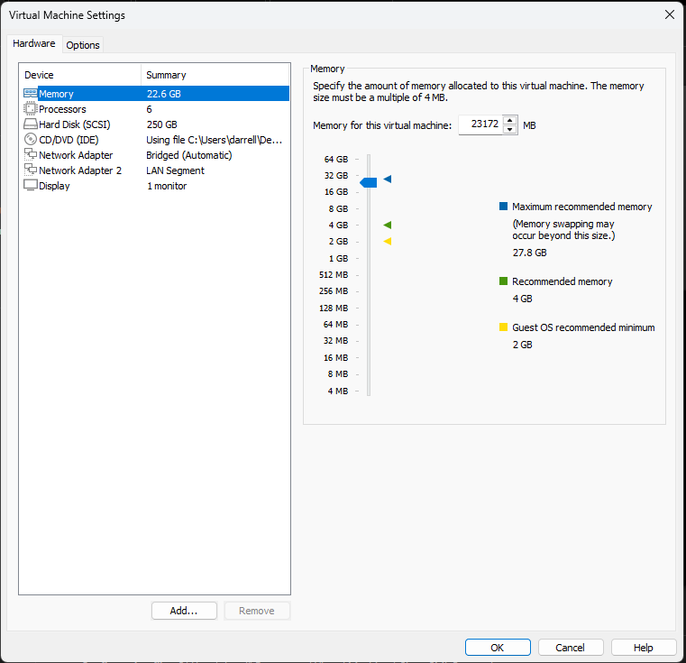
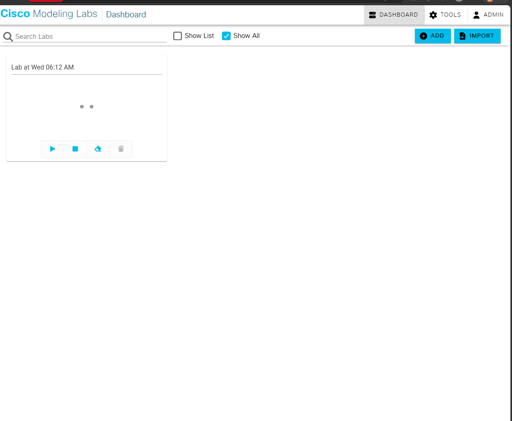
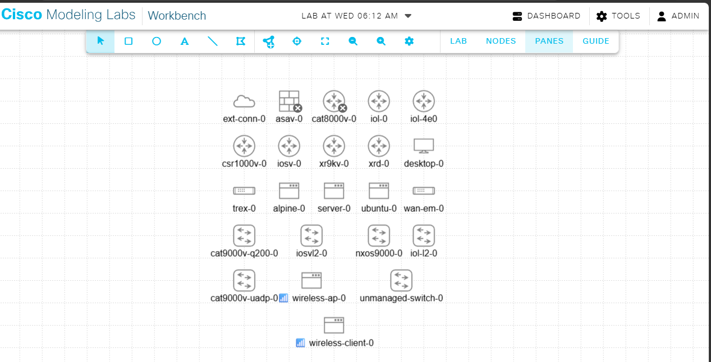
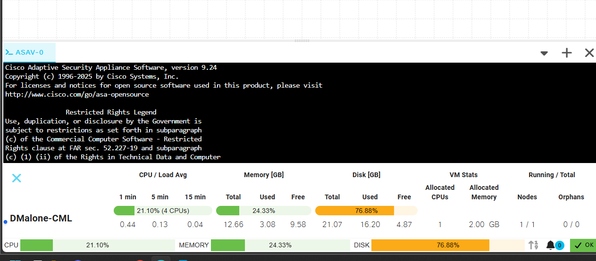
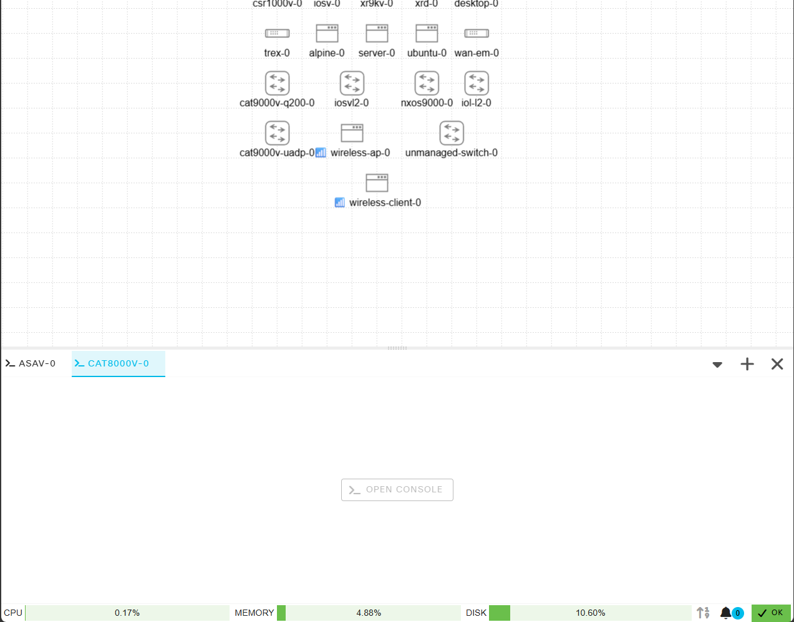

# Cisco CML Personal Lab

My Cisco Modeling Labs (CML) Personal setup running in VMware Workstation.

I started with CML Free and upgraded to CML Personal because I wanted a larger lab and the ability to connect virtual labs to real network devices.

## My Setup

- **PC:** Alienware Aurora R16
- **CPU:** Intel Core i7-14700F
- **Host RAM:** 32 GB
- **Hypervisor:** VMware Workstation
- **Lab platform:** Cisco CML Personal

### CML Virtual Machine

- **CPU:** 6 vCPUs
- **Memory:** 22.6 GB
- **Virtual disk:** 250 GB

## CML Is Up and Running

CML is installed, licensed, and ready for lab work.

## Cisco Images

These are the node types available in my CML setup.

## Storage Fix

I ran into a storage issue during setup. I expanded the virtual disk and maximized CML's lab storage.

**Before:**

**After:**

## Why I'm Using CML

One feature that attracted me to CML is the ability to connect a lab to real network equipment using external connectivity. I want to experiment with connecting virtual devices to physical devices on my home network.

I also want to connect my CML environment to my existing GNS3 environment. The goal is to build services in CML and make them available to devices in GNS3.

## What's Next

- Build routing and switching labs.
- Practice VLANs, trunks, and routing.
- Test network security.
- Build server services inside CML.
- Set up Cisco CME (Call Manager Express) in CML.
- Connect the CML and GNS3 environments.
- Test access to CML-hosted services from my GNS3 labs.
- Experiment with connecting CML to real network equipment.

This is an ongoing project. I'll add more as I build and improve my lab.

**Note:** Cisco images, license keys, and passwords are not included in this repository.
